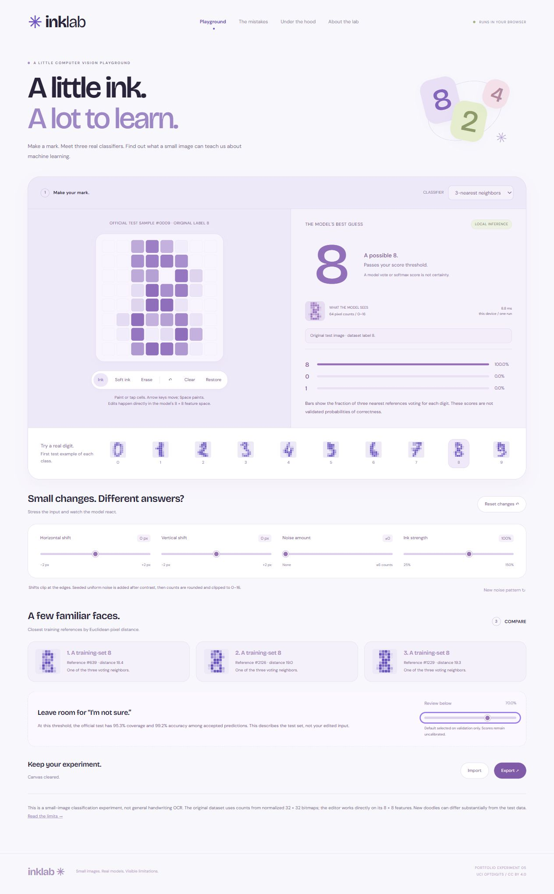

# InkLab / A Handwriting Playground

[](https://github.com/Boody700/inklab-vision/actions/workflows/checks.yml)

**Interactive digit classification, an inspectable error gallery and repeatable robustness experiments.**

[Case study](docs/case-study.md) · [Interview notes](docs/interview-guide.md) · [Validation workflow](.github/workflows/checks.yml)

An end-to-end computer-vision portfolio project with a different visual identity: an editable pixel canvas, oversized live digit, a strip of real examples, and an inspectable error gallery.

**[Open the private demo](https://inklab-abdelrahman-2026.solarcorgi36.chatgpt.site)**



## What it does

- Paint an 8 × 8 image using full ink, soft ink or an eraser; tap cells or use arrow keys and Space. Undo the last 30 strokes.
- Compare three real classifiers: linear softmax, deterministic 3-nearest neighbors and a small ReLU neural network.
- Shift, weaken or add seeded noise to the input and see actual local inference change.
- Inspect the top three model scores and the transformed input; compare the closest training references.
- Explore every held-out test mistake, filter actual/predicted digits and open confusion-matrix cells in the gallery.
- Adjust a review threshold and inspect its observed test coverage/accepted accuracy.
- Export/import validated local JSON experiments and download the complete benchmark report.

This is a **feature-space digit lab**, not a general handwriting OCR system. The editor works directly on 64 pixel counts, bypassing the dataset's original 32 × 32 normalization. Scores on new doodles have not been validated.

## Results, without hiding the weak points

The official Optdigits files contain 3,823 training examples from 30 writers and 1,797 test examples from 13 different writers. A stratified 80/20 split of the official training file selects the model; final models are refitted on all official training rows before testing. All 3,823 training vectors are unique, and none exactly matches a test vector.

| Model | Validation accuracy | Official-test accuracy | Test macro F1 |
|---|---:|---:|---:|
| Linear softmax | 96.08% | 95.10% | 0.9511 |
| 3-nearest neighbors / selected | 98.95% | **97.83%** | **0.9783** |
| Small neural network | 98.04% | 96.33% | 0.9633 |

The selected classifier gets **1,758/1,797** correct, with **39 visible mistakes**. Its approximate per-image Wilson 95% accuracy interval is 97.05–98.41%; this does not account for clustering by writer and is not a guarantee for unseen writers or drawings.

A validation-selected review threshold of 0.70 accepts 95.27% of official test images with 99.24% accuracy among accepted predictions. Nearest-neighbor scores are discrete vote fractions, not calibrated probabilities. Thirteen unanimous but incorrect test predictions still pass that threshold.

The same classifier falls to **65.83% accuracy after a one-pixel right shift**. Noise of ±4 counts gives 97.50%; half contrast gives 93.77%. These controlled stress tests show that good normalized-image results do not establish broad robustness. The neural candidate hit its fixed 350-iteration cap before convergence; its result is preserved and labelled rather than hidden or retuned on the test.

## Run the prebuilt app

Node.js 22+; no npm dependency installation or API key is required.

```powershell
npm start
```

Open `http://127.0.0.1:4177`. Any static HTTP server can serve `dist/`. Opening `index.html` directly as a file will not reliably load the JSON assets.

## Reproduce

Python 3.12 is the reference environment; actual versions and hashes are in [evaluation.json](reports/evaluation.json).

```powershell
python -m venv .venv
.venv/Scripts/python -m pip install -r requirements.txt
.venv/Scripts/python scripts/download.py
.venv/Scripts/python scripts/train.py
.venv/Scripts/python -m unittest discover -s tests -p "test_*.py"
npm test
```

Use `.venv/bin/python` on Linux/macOS. The downloader saves only the official feature files and documentation, not the source ZIP. Training regenerates portable model JSON, every test sample/prediction, robustness results and full-probability parity fixtures. The included small dataset files and prebuilt app allow offline reproduction after dependencies are installed. The neural optimizer may report its documented convergence warning at the fixed cap.

**Seven Python checks and ten Node checks pass.** The parity test covers all 5,391 model/image combinations; the maximum JavaScript/Python probability difference was 2.55 × 10⁻¹⁵. The robustness test reproduces all six stress conditions across all 1,797 test images using the same seeded transforms. Other checks cover data/split hashes, metrics, model/threshold selection, ties, blank inputs, numeric stability and JSON import bounds. GitHub Actions validates the committed classifiers and robustness fixtures.

## Structure

- `scripts/download.py`: official source acquisition and checksums.
- `scripts/train.py`: fixed candidates, validation selection, official test, robustness and portable export.
- `dist/vision.mjs`: browser inference, transforms and experiment validation.
- `dist/app.mjs`: pixel editing, model comparison, gallery, review controls and local JSON files.
- `reports/evaluation.json`: complete scores, split policy, model parameters and provenance.
- `reports/parity-reference.json`: full Python probability arrays used by Node verification.
- `data/`: official train/test feature files, source documentation and manifest.

The [shareable evaluation figure](reports/evaluation.png) combines model comparison, stress tests, confusion counts and the first six mistakes in file order. To regenerate it, install `requirements-report.txt` and run `python scripts/plot_report.py`. Plotting is optional and not needed by the app.

## Read before presenting

- [Case study](docs/case-study.md)
- [Model and data card](docs/model-data-card.md)
- [Architecture](docs/architecture.md)
- [Interview guide](docs/interview-guide.md)
- [Validation record](docs/validation.md)

Dataset: Alpaydin, E. & Kaynak, C. (1998). *Optical Recognition of Handwritten Digits*. UCI Machine Learning Repository. [DOI 10.24432/C50P49](https://doi.org/10.24432/C50P49), [CC BY 4.0](https://creativecommons.org/licenses/by/4.0/). The exported models and perturbed examples are adaptations. Original implementation is MIT licensed; see [third-party notices](THIRD_PARTY_NOTICES.md). No endorsement is implied.

Run the project, read the inference and split code, and be prepared to explain its failures in your own words.


## Development

Independent educational portfolio project. The source, evaluation design and limitations are documented so the work can be inspected and reproduced. GitHub Actions runs the committed browser checks. Python pipeline reproduction uses the commands and data sources described above.
